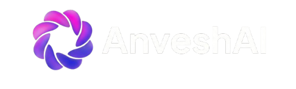

<div align="center">
  <picture>
    
  </picture>
</div>
<hr>
<div align="center" style="line-height: 1;">
  <a href="https://huggingface.co/AnveshAI" target="_blank"></a>
  <a href="https://www.apache.org/licenses/LICENSE-2.0" target="_blank"></a>
</div>
<div align="center" style="line-height: 1;">
  <a herf="#"></a>
  
  
  
  
</div>
**Ritchie** is a compact 100.7M-parameter language model purpose-built for **C programming** — named after [Dennis Ritchie](https://en.wikipedia.org/wiki/Dennis_Ritchie), the creator of the C language. Built on the LLaMA architecture, Ritchie is designed to generate C code from natural language task descriptions.

**Small enough to run on any device — including edge devices like smartphones, tablets, Raspberry Pi, and other embedded hardware.** At just ~200MB (FP16), Ritchie brings C code generation to devices where larger models simply can't run. No GPU required — it runs comfortably on CPU.

---

## Highlights

- **100.7M parameters** — one of the smallest dedicated C code generation models available
- **~200MB model size** (FP16) — fits in memory on virtually any device
- **Runs on CPU** — no GPU required, works on laptops, phones, edge devices, and embedded systems
- **LLaMA architecture** — well-supported by HuggingFace Transformers, llama.cpp, ONNX, and other runtimes
- **Task-oriented special tokens** — structured prompting with `<|task|>`, `<|code|>`, `<|plan|>`, `<|bug|>`, `<|fix|>` tokens
- **2048 token context window**

---

## Model Details

| Property | Value |
|----------|-------|
| **Model Name** | AnveshAI Ritchie 0.1B |
| **Parameters** | 100.7M |
| **Architecture** | LlamaForCausalLM |
| **Hidden Size** | 768 |
| **Intermediate Size** | 2048 |
| **Layers** | 12 |
| **Attention Heads** | 12 |
| **KV Heads** | 4 (Grouped Query Attention) |
| **Vocab Size** | 32,768 |
| **Max Context** | 2,048 tokens |
| **Precision** | FP16 |
| **Activation** | SiLU |
| **Position Encoding** | RoPE (θ=10000) |
| **Tied Embeddings** | Yes |
| **Training Step** | 3,200 |
| **Eval Loss** | 1.383 |
| **Model Size on Disk** | ~192 MB |

---

## Quick Start

### Installation

```bash
pip install transformers torch
```

### Basic Usage

```python
import torch
from transformers import AutoModelForCausalLM, AutoTokenizer
model_name = "AnveshAI/Ritchie-0.1B"  # Update with your HF repo path
tokenizer = AutoTokenizer.from_pretrained(model_name)
model = AutoModelForCausalLM.from_pretrained(
    model_name,
    torch_dtype=torch.float16,
    device_map="auto",
)
model.eval()
prompt = "<|task|>Write a C function to compute the nth Fibonacci number<|code|>"
inputs = tokenizer(prompt, return_tensors="pt").to(model.device)
with torch.no_grad():
    output = model.generate(
        **inputs,
        max_new_tokens=256,
        do_sample=True,
        temperature=0.4,
        top_p=0.95,
        repetition_penalty=1.15,
        pad_token_id=tokenizer.pad_token_id,
    )
generated = output[0][inputs["input_ids"].shape[1]:]
print(tokenizer.decode(generated, skip_special_tokens=True))
```

---

## Special Tokens

Ritchie uses structured special tokens for different stages of the code generation pipeline:

| Token | Purpose | Description |
|-------|---------|-------------|
| `<\|bos\|>` | Beginning of sequence | Start of input |
| `<\|end\|>` | End of turn | End of generation |
| `<\|eos\|>` | End of sequence | End of full sequence |
| `<\|pad\|>` | Padding | Padding token |
| `<\|task\|>` | Task description | Precedes the natural language instruction |
| `<\|code\|>` | Code generation | Signals the model to start generating code |
| `<\|plan\|>` | Planning | For step-by-step planning before coding |
| `<\|run\|>` | Execution | Marks expected execution output |
| `<\|bug\|>` | Bug identification | Marks compiler errors or bugs |
| `<\|fix\|>` | Bug fix | Signals corrected code |

### Prompt Format

```
<|task|>Your natural language description here<|code|>
```

---

## Tips for Best Results

1. **Use `repetition_penalty=1.15`** — helps prevent repetitive output patterns
2. **Keep `max_new_tokens` at 256** — the model works best with shorter outputs
3. **Use `temperature=0.4`** — lower temperature produces more focused code
4. **Use the `<|task|>...<|code|>` format** — this is the prompt format the model was trained on
5. **Simple, direct prompts work best** — e.g., "Write a C function to swap two integers using pointers"
---
## Limitations
- **100M scale** — this is a small model; expect imperfect outputs on complex tasks
- **C language only** — not trained for other programming languages
- **May produce repetitive output** — use `repetition_penalty` to mitigate
- **Not instruction-tuned** — this is a base code generation model, not a chatbot
- **May not always follow the task** — task adherence is limited at this model scale

---

## Training Details

- **Base Architecture**: LLaMA (custom configuration)
- **Training Data**: C language source code corpus
- **Optimizer**: AdamW
- **Precision**: FP16 mixed precision
- **Best Checkpoint**: Step 3,200 (selected by lowest eval loss)
- **Hardware**: Kaggle GPU environment

---

## Citation

```bibtex
@misc{anveshai-ritchie-2026,
  title={AnveshAI Ritchie 0.1B},
  author={AnveshAI},
  year={2026},
  url={https://huggingface.co/AnveshAI/Ritchie-0.1B}
}
```

---

## License

This model is released under the [Apache 2.0 License](https://www.apache.org/licenses/LICENSE-2.0).

---

<p align="center">
  <b>Built by <a href="https://huggingface.co/AnveshAI">AnveshAI</a></b><br>
  <i>Named after Dennis Ritchie — the father of C</i>
</p>
